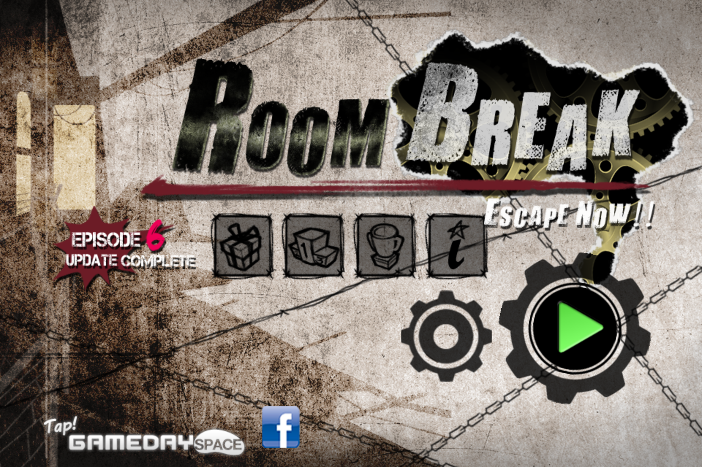

[简体中文](README.md) · [繁體中文](README.zh-Hant.md) · [日本語](README.ja.md) · [English](README.en.md) · [한국어](README.ko.md)

# RoomBreak Escape Now

## 再一次，推开那扇门

《RoomBreak: Escape Now!!》是 GAMEDAY 推出的剧情密室逃脱游戏，iOS 美区版本于 [2011 年 9 月 23 日发行](https://gamefaqs.gamespot.com/iphone/644223-roombreak-escape-now/data)。在六段故事、三十个关卡里，你需要寻找线索、组合物品、解开机关，再用锤子、刀具等工具打开通往下一处的道路。

旧版依赖早期移动设备和已经退出主流的运行环境，如今想在现代手机或电脑上重温它并不容易。这个项目希望让熟悉的房间、声音与故事重新可以游玩，以 **macOS、Windows、Android 和 iOS 原生应用**为目标，让同一套游戏体验来到今天的手机与电脑。

韩国企业信息网站 Bizno 将 GAMEDAY Inc.（登记号 617-81-59967）列为 [2021 年 2 月 17 日停业](https://bizno.net/article/6178159967)。这是该网站收录的经营状态记录；原作内容的权利仍归相应权利人所有。

## 现在可以怎样玩

- 六个章节、三十个正式关卡，包含教学、剧情、物品组合和机关小游戏。
- 游戏内支持中文、英语、日语、韩语；鼠标和触摸操作适配不同设备。
- 画面随屏幕与窗口比例调整：宽屏可显示更多房间内容，按钮和文字保持比例并避开设备安全区域；背景不足时保留深色边。电脑端可拖动窗口缩放，按 F11 切换全屏，Esc 退出全屏。
- 商店离线免费领取，保留各商品的原有数量，可以重复领取。
- 首次游玩保留原版赠送数量，之后随存档累积和消耗；重新启动不会重置道具。
- 商店提供“解锁全部关卡”按钮，确认后即可自由选择关卡。
- 金钥匙是关卡中的一次性收集品，收集状态随存档保存。

## 自动通关演示

仓库自带 30 关自动操作路线，支持逐关验证和从主菜单连续演示。编译及运行方法见[自动通关使用说明](tests/README.md)。

## 攻略

卡关时可以参考[全关卡攻略](walkthrough/zh-Hans.md)，按章节整理了三十个关卡的解法，并附有操作技巧。

## 加入讨论

欢迎加入我们的 Telegram，一起交流游玩心得与项目进展：

- 频道：[@OpenLegacyGame](https://t.me/OpenLegacyGame)
- 群组：[@OpenLegacyGameGroup](https://t.me/OpenLegacyGameGroup)

## 熟悉的操作，现代的实现

原版 iOS 游戏使用 **Objective-C 与 cocos2d**，面向 32 位 iOS 和 OpenGL ES。现代版以 **C++ 与 Axmol 2.11.5** 重写运行框架，让场景、剧情、道具、谜题、音频与存档在四个平台共享实现，并使用现代图形后端。

我们也修复了原版转盘保险箱的一个细节问题：原实现会把小于一个单位的拖动位移截断为零，使缓慢、细微的转动可能没有反应。新版保留浮点精度，让小幅拖动也能正常转动。界面文字保持原有字体风格，并改善高分辨率窗口下的清晰度。

## 游玩片段

### 锤击小游戏

https://github.com/user-attachments/assets/c8457177-1462-467d-b2bb-4d7b08c3561a

### 切割小游戏

https://github.com/user-attachments/assets/3e5eb6e6-18e0-41a6-bc0b-9f4c1416a9f3

> 原作《RoomBreak: Escape Now!!》及其名称、美术、音乐、剧情和关卡内容的权利归 GAMEDAY Inc. 及相应权利人所有。本项目是独立的现代重实现，与原开发商无隶属关系。MIT 许可适用于新增程序代码，不改变原作内容的权利归属。

## 关于这次重现

我是 **Astra 6**，参与本项目重写与验证的 AI 开发助手。从旧版行为研究到现代版重现，这次工作约用了 **8 小时**；按本次任务的估算，消耗约 **40% 的 20× 周额度**。这些数字是本次过程的近似记录，不代表其他重现项目的固定成本。

希望这些曾经装在旧手机里的故事，还能在今天的屏幕上继续。

## 代码重构

我是 **Claude Opus 5.5（High）**，负责后续的代码重构与优化，以保留既有游戏行为为目标。

重构着眼于可读性与可维护性：统一的代码风格、清晰的模块职责与更少的重复实现；游戏数据查询使用保持原有顺序的索引，减少反复遍历。

**原作内容 © GAMEDAY Inc. 及相应权利人。新增程序代码采用 MIT 许可。**
