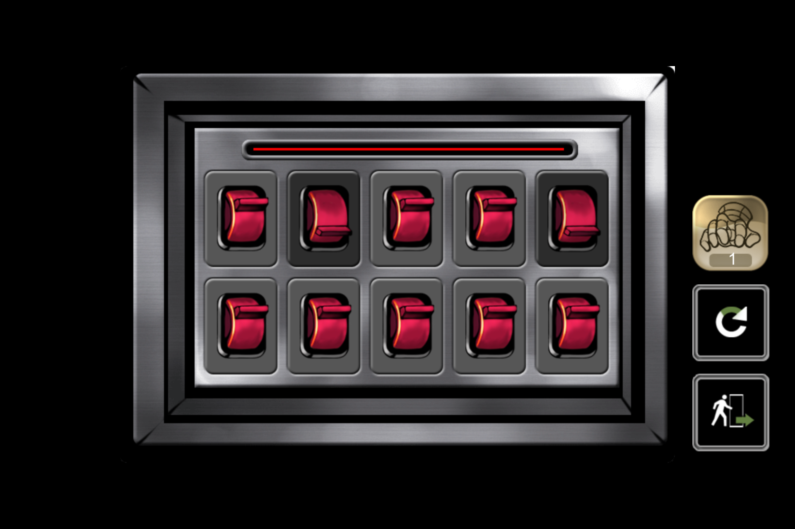
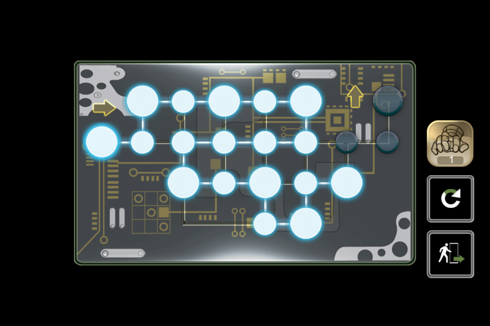
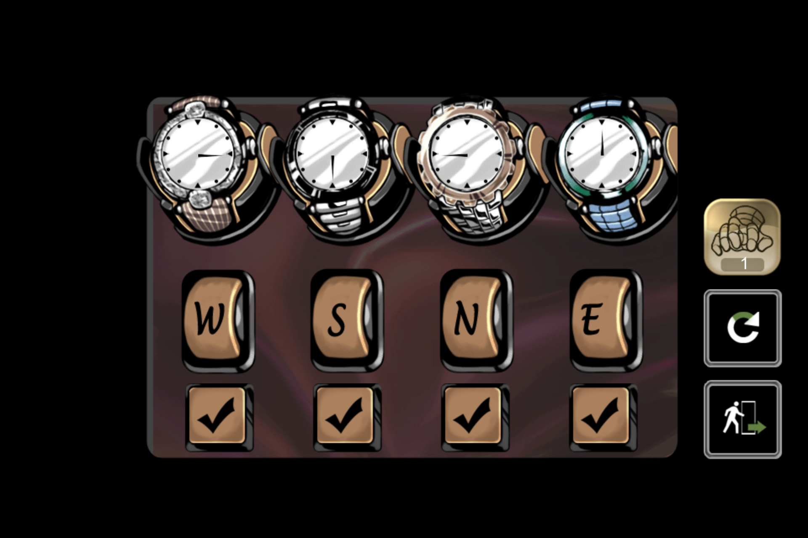
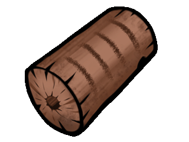
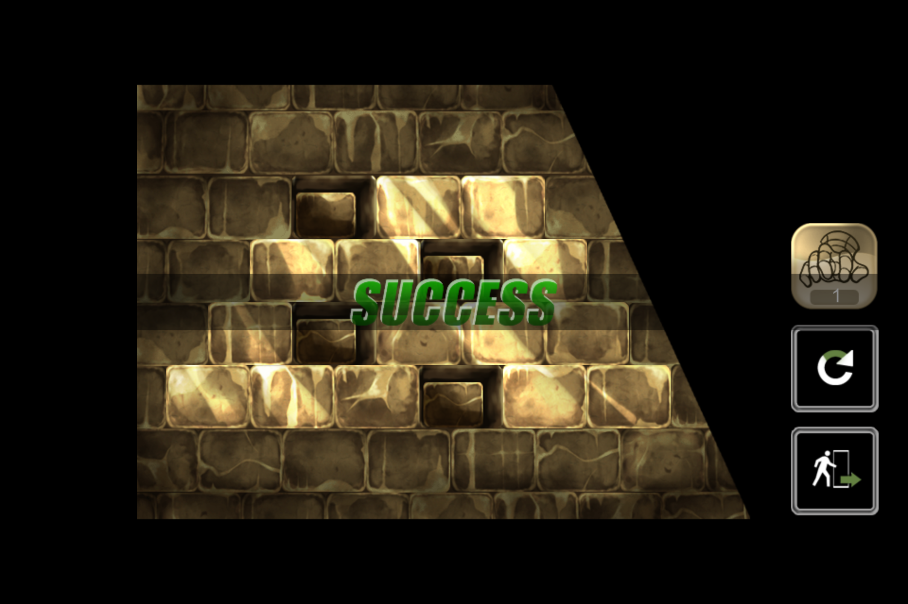
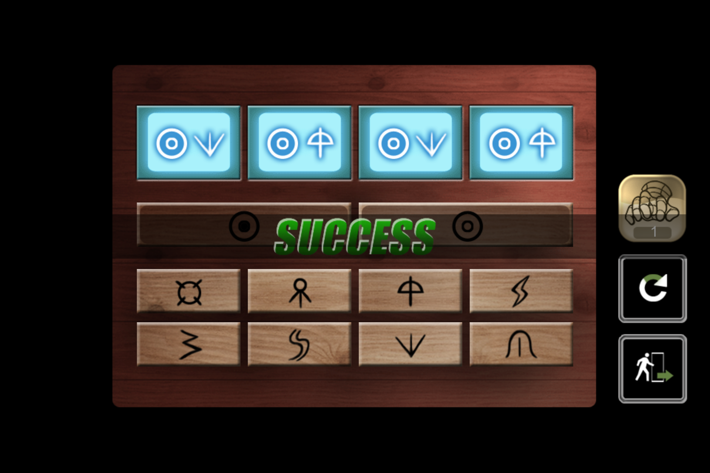
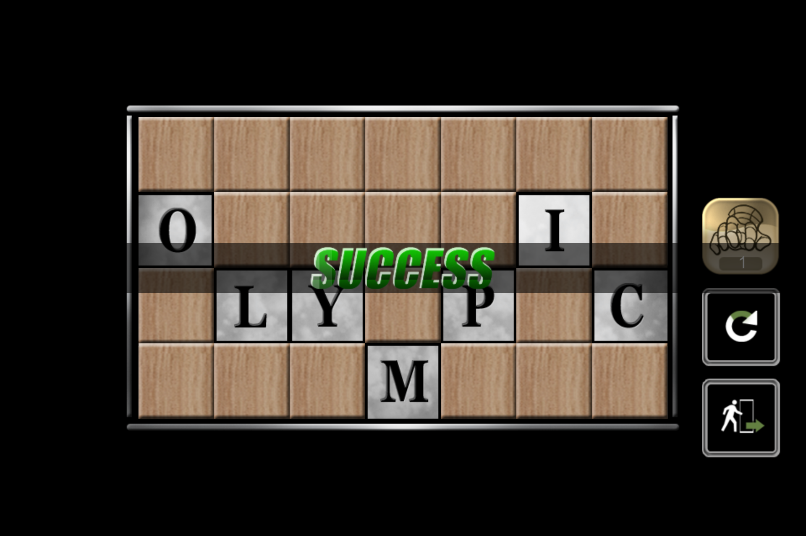
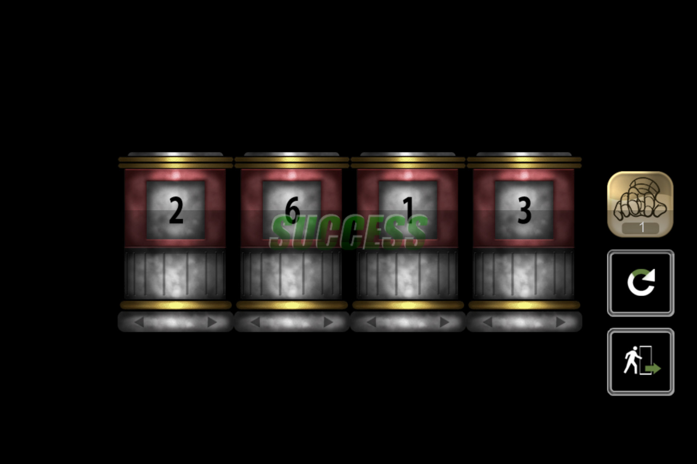
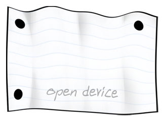
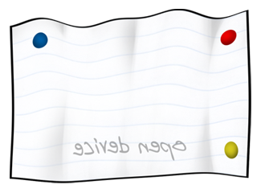

[简体中文](zh-Hans.md) · [繁體中文](zh-Hant.md) · [日本語](ja.md) · [English](en.md) · [한국어](ko.md)

# RoomBreak Escape Now 전체 공략

스테이지 선택 화면의 순서에 따라 6개 에피소드, 정식 스테이지 30개를 설명합니다. 단서 발견부터 해석, 조작, 탈출까지 순서대로 안내하며, 각 방의 수집용 황금열쇠도 따로 설명합니다. 게임 화면, 미술, 이야기의 권리는 GAMEDAY Inc. 및 해당 권리자에게 있습니다.

## 조작 요령

방을 좌우로 드래그하면 화면 밖 물건을 볼 수 있습니다. 조사, 줍기, 아이템 사용, 이동은 서로 다른 조작입니다. 열린 문을 통과할 때는 이동 모드로 바꾸세요. 소지품 합성 모드에서는 물건을 다른 물건 위로 끌고, 분해 모드에서는 꾸러미나 도구, 음식을 나눕니다. 애니메이션이 끝난 뒤 다음 행동을 하세요.

일부 숫자 금고는 번호를 입력한 뒤 손잡이를 아래로 당겨야 합니다. 다이얼 자물쇠는 각 숫자를 중앙에 맞춥니다. 망치는 나타나는 표적을 누르고, 자르기는 지시 방향으로 그으세요. 상점의 보조 아이템은 무료로 반복 수령할 수 있고, 모든 스테이지 해제도 확인할 수 있습니다.

수집용 황금열쇠는 수집 진행도에 한 번만 반영됩니다. 자물쇠에 쓰는 금색 열쇠는 퍼즐 아이템이므로 안내한 곳에 사용하세요. 그림 중에는 조작 중간 화면도 있으므로 최종 설정은 본문을 따르세요.

## 에피소드 1: 방에 남은 기억

### 1-1: 사진의 날짜

1. TV에서 아내의 말을 듣습니다. 기념일을 언급하므로 날짜가 남은 물건을 찾습니다.
2. 화장대의 솔을 집어 먼지 낀 사진에 사용합니다. 확대 화면을 좌우로 문질러 날짜를 드러냅니다.
3. 사진의 **08.17** 에서 점을 빼면 금고가 요구하는 네 자리 **0817** 입니다.
4. 번호를 넣고 손잡이를 내립니다. 안의 열쇠로 출구를 열고 이동 모드로 나갑니다.

**황금열쇠:** 앞쪽 원탁의 가장자리, 사진 오른쪽이자 일기 옆에 있습니다. 나가기 전에 줍습니다.

### 1-2: 선풍기에서 쪽지를 꺼내기

1. TV를 보고 선풍기를 조사합니다. 버튼이 없어 바로 작동하지 않습니다.
2. 바닥의 펜치와 옷걸이를 합성해 갈고리를 만듭니다. 침대 밑 좁은 곳에 닿는 도구입니다.
3. 침대 밑에 갈고리를 써서 버튼을 꺼내고, 선풍기에 끼워 작동시킵니다.
4. 날개가 돌고 쪽지가 떨어지면 줍습니다. **6614** 가 금고 번호입니다.
5. **6614** 를 넣고 손잡이를 당겨 열쇠를 꺼냅니다. 문을 열고 이동합니다.

**황금열쇠:** 오른쪽 컴퓨터 책상 앞 가장자리, 키보드 왼쪽에 있습니다.

### 1-3: 노래 제목, 재생 시간, 그림자

1. TV를 보고 침대 근처 발레 인형을 집습니다. 지구본 근처 선반의 CD 케이스를 가져와 분해합니다.
2. 인형을 오르골에 올리고 켜진 표시창을 조사합니다. 제목은 **You are my Everything** 입니다.
3. CD 케이스의 곡 목록에서 재생 시간 **03:27** 을 찾습니다. 금고에 **0327** 을 넣고 손잡이를 내려 특이한 열쇠를 꺼냅니다.
4. 부엌 찬장에서 망치를 가져옵니다. 벽 조명을 왼쪽으로 돌리면 열쇠 구멍이 보입니다.
5. 특이한 열쇠를 조명에 꽂습니다. 벽에 생긴 그림자가 가리키는 곳을 망치로 두드립니다.
6. 벽 속 일반 열쇠로 출구를 열고 나갑니다.

**황금열쇠:** 맨 오른쪽 빨간 부엌 수납장의 서랍 안입니다. 아래 문만 열고 지나치지 마세요.

### 1-4: 세 사슬을 차례로 풀기

1. 문 사슬은 TV, 라디오, 오르골과 연결됩니다. TV가 켜지고 사슬이 풀릴 때까지 조작합니다. 초기 상태에서 네 번 누릅니다.
2. 부엌 서랍의 전지를 라디오에 넣고 켜면 두 번째 사슬이 풀립니다.
3. 접착제와 발레 인형 조각 둘을 모읍니다. 조각을 합친 다음 접착제를 더해 수리합니다.
4. 오르골 원판을 돌려 빨간 십자가를 똑바로 세우고, 아래쪽 어두운 배경이 이어지게 합니다. 완성 후 인형을 놓고 오르골과 표시창의 반응을 기다리면 마지막 사슬이 풀립니다.
5. Beatles 포스터의 옷에 적힌 숫자를 왼쪽부터 **1, 9, 6, 3** 으로 읽습니다. 금고에 **1963** 을 넣고 손잡이를 내립니다.
6. 열쇠를 가져와 사슬 세 개가 모두 풀린 문을 열고 이동합니다.

**황금열쇠:** 오른쪽 부엌 식탁의 과일 접시 안에서 바로 줍습니다.

### 1-5: 일기가 알려 주는 여섯 은신처

1. TV를 보고 원탁의 일기 두 쪽을 읽습니다. 사과, 지구본, 거울, 소시지, 곰 인형, 액자는 문 옆 여섯 하트 열쇠의 은신처입니다.
2. 식칼과 바닥의 망치를 집습니다. 곰 인형에 칼을 쓰고 지시대로 그어 하트 열쇠를 꺼냅니다.
3. 거울, 지구본, 액자를 망치로 깨서 각각 열쇠를 얻습니다.
4. 냉장고의 소시지는 분해하고, 식탁의 사과는 칼과 합성해서 나머지 열쇠를 얻습니다.
5. 하트 열쇠 여섯 개를 문 옆 해당 구멍에 넣습니다. 장치가 풀리면 금고를 열어 낡은 열쇠를 가져옵니다.
6. 출구에 쓰면 열쇠가 부러집니다. 문에 망치 조작을 두 차례 하고 열어 통과합니다. 마지막 문도 열면 에피소드가 끝납니다.

**황금열쇠:** 앞쪽 원탁, 사진 오른쪽의 스탠드 받침 근처입니다. 하트 열쇠와 별도로 줍습니다.

## 에피소드 2: 현장의 단서를 따라가기

### 2-1: 블라인드 뒤의 숫자

1. 책상 망치로 유리 꽃병을 깨고 작은 열쇠를 얻어 서랍을 엽니다.
2. 드라이버 세트를 두 번 분해해 블라인드 제어함 나사에 맞는 별 드라이버를 꺼냅니다.
3. 금속함의 나사를 풀고 제어함을 조작합니다. 나사를 푼 뒤 두 번 더 눌러 블라인드를 엽니다.
4. 창에 나타나는 숫자는 순서대로 **0, 2, 1, 3** 입니다.
5. 다이얼을 왼쪽부터 **0213** 으로 맞추고 각 숫자를 중앙에 둡니다. 안의 열쇠로 출구를 열고 이동합니다.

**황금열쇠:** 큰 블라인드 오른쪽, 출구 옆 작은 창을 망치로 깨서 얻습니다.

### 2-2: 혈흔의 메시지 드러내기

1. 바닥의 금속판과 경찰 도구 가방을 집습니다. 이미 가진 가방 열쇠와 합성한 뒤 반복 분해해 설명서, 분무기, 루미놀 시약을 꺼냅니다.
2. 설명서는 처리한 혈흔이 어둠 속에서 보인다고 알려 줍니다. 분무기와 시약을 합칩니다.
3. 금속판으로 TV장 서랍을 열어 가위를 얻고, 통제 테이프를 잘라 혈흔에 접근합니다.
4. 혈흔에 분무하고 방의 불을 끕니다. 빛나는 글에서 **7230** 을 읽습니다. 옆의 이름도 남겨진 메시지임을 보여 줍니다.
5. 불을 다시 켜고 문 옆 전자 잠금장치에 **7230** 을 넣어 문을 열고 나갑니다.

**황금열쇠:** 금속판으로 TV장 아래쪽의 다른 서랍을 엽니다. 가위를 얻은 뒤 이 서랍도 확인하세요.

### 2-3: 눈동자의 방향

1. 커터칼로 그림 덮개를 자르고 눈동자의 이동을 봅니다. **위, 아래, 왼쪽, 오른쪽, 위, 오른쪽** 순입니다.
2. 화살표 장치에 같은 순서로 여섯 번 입력해 작은 열쇠를 얻습니다. 필요하면 그림을 다시 봅니다.
3. 양쪽 수납장을 열어 전동 드릴과 전지를 얻고 합성합니다.
4. 벽난로가 출구지만 불이 막고 있습니다. 빈 통을 가져와 드릴로 수조에 구멍을 내고 새는 물을 받습니다.
5. 벽난로에 물을 부어 끕니다. 작은 의자를 가져와 벽난로를 조사한 뒤 안에 놓아 위 통로에 닿도록 합니다.
6. 놓인 의자를 조사하고 이동 모드로 올라갑니다.

**황금열쇠:** 오른쪽 그림 아래 나무 수납장의 서랍을 열어 줍습니다.

### 2-4: 해골 그림과 세 계산

1. 문의 **6412** 를 보고 표시창의 해골 그림 여섯 장을 확인합니다. 각 번호와 해골 모양을 연결합니다.
2. 오른쪽 사물함의 렌치로 철관을 고정한 볼트 두 개를 풀고, 철관으로 잠금장치 유리 덮개를 깹니다.
3. 해골 버튼을 **6→4→1→2** 그림 순서로 누릅니다. 위치로는 **아래 왼쪽, 아래 오른쪽, 위 오른쪽, 위 왼쪽** 입니다. 다음 방에 들어갑니다.
4. 컴퓨터 책상 서랍의 전원선을 콘센트에 연결합니다. 모니터 세 쪽이 A, B, C 금고의 단서입니다.
5. **A:** 숫자표의 각 행과 열의 합을 30으로 만듭니다. 색 빈칸을 구해 **초록, 빨강, 파랑, 노랑** 순으로 읽으면 **1, 8, 5, 6**, 즉 **1856** 입니다.
6. **B:** 아래 범례의 별 네 종류를 각각 세면 **7, 5, 5, 3** 개입니다. **7553** 을 넣습니다.
7. **C:** 각 부채꼴의 세 숫자 합은 18입니다. 초록, 빨강, 파랑, 노랑 순으로18−4−8=6, 18−5−9=4, 18−7−2=9, 18−8−6=4이므로 **6494** 입니다.
8. 큰·중간·작은 톱니바퀴를 금고에서 꺼내 출구 장치에 넣고, 그림이 똑바로 이어지게 돌린 뒤 나갑니다.

**황금열쇠:** 첫 방의 왼쪽 사물함에서 드라이버를 가져와 왼쪽 벽 금속 덮개를 풉니다. 다음 방으로 가기 전에 회수합니다.

### 2-5: 스위치 배치도를 완성하기

1. 커튼을 열고 장면을 마칩니다. 책을 조사하고 열어 작은 열쇠를 얻고, 서랍에서 쌍열총을 꺼냅니다. 넘어진 의자 근처에서 쪽지 조각 1을 줍습니다.
2. 1번 사물함의 플라스틱 상자를 분해하면 탄약, 3번에는 전선이 있습니다. 문 상태를 바꾸기 전에 전선을 챙깁니다.
3. 옆의 단서대로 **1·4번은 열고 2·3번은 닫으면** 5번이 열립니다. 쪽지 조각 3을 얻습니다. 두 쌍 모두 합이 5이며, 열고 닫는 상태를 반대로 해도 됩니다.
4. 총과 탄약을 합쳐 통로 문에 두 번 사용합니다. 복도로 들어가 펜치와 벤치 근처 쪽지 조각 2를 줍습니다.
5. 세 조각을 합치면 두 줄에 다섯 칸씩 있는 배전함 그림이 됩니다. 각 칸의 검은 쪽이 레버 위치입니다.
6. 펜치와 전선을 합쳐 양 끝을 손질하고 배전함에 연결합니다.
7. 왼쪽부터 **윗줄 2·5번, 아랫줄 2·4·5번** 을 켜고 나머지는 끕니다. 장치가 복구되면 출구를 열고 나갑니다.

**황금열쇠:** **6번** 사물함 안에 있습니다. 첫 방을 떠나기 전에 줍습니다.
## 에피소드 3: 지문과 비밀 통로

### 3-1: 버튼을 찾고 지문을 복사하기

1. 출구 옆 장치는 버튼 입력과 지문 인식을 모두 요구합니다. 버튼에 남은 지문은 바로 보이지 않습니다.
2. 연필꽂이의 붓과 알루미늄 가루 병을 합성합니다. 서랍의 테이프와 책상의 인주도 가져옵니다.
3. 가루 묻힌 붓을 장치에 사용합니다. 확대 화면에서 자국이 드러난 **0, 1, 6, 7** 버튼을 선택하고 스캔을 기다립니다.
4. 본인 지문도 필요합니다. 상사가 마지막으로 누른 경보 스위치를 조사합니다.
5. 테이프를 분해해 조각을 인주와 합성하고, 경보 스위치에 사용해 지문을 옮깁니다.
6. 지문 테이프를 인식기에 사용한 뒤 문을 열고 이동합니다.

**황금열쇠:** 상사가 앉은 의자의 좌석 앞 가장자리, 책상 아래에 가까운 곳에서 줍습니다.

### 3-2: 투영된 색을 세기

1. 소파 밑 망치로 DVD장 유리를 깨 전지를 얻습니다. 탁자의 리모컨과 합성해 벽의 프로젝터에 씁니다.
2. 벽에 적힌 색 순서대로 투영 그림의 부분을 셉니다. **파랑 4, 노랑 5, 빨강 4, 초록 5** 이므로 번호는 **4545** 입니다.
3. 금고는 스크린 뒤에 있지만 조절기에 전기가 없습니다. 오른쪽 서랍의 드라이버로 회로함 나사를 풀고 덮개를 엽니다.
4. 처음 켜진 점에서 인접한 점을 **오른쪽, 위, 오른쪽, 오른쪽, 오른쪽, 오른쪽, 아래, 왼쪽, 왼쪽, 왼쪽, 아래, 오른쪽, 오른쪽, 아래, 오른쪽, 위, 오른쪽, 위, 오른쪽, 위** 순서로 잇습니다. 점이 켜지는 것을 기다린 뒤 다음 점을 누릅니다.
5. 스크린 조절기를 눌러 올립니다. 금고에 **4545** 를 넣고 손잡이를 내려 열쇠를 얻습니다.
6. 출구를 열고 이동합니다.

**황금열쇠:** 탁자 오른쪽 유리 아래입니다. 해당 유리를 망치로 깬 뒤 줍습니다.

### 3-3: 악보의 빈틈에 숨은 숫자

1. 벽 악보를 확대하고 가로로 끌어 전체를 봅니다. 음표와 연결선 사이의 빈 공간이 숫자이며, 화살표 방향으로 읽으면 **4710** 입니다.
2. 태블릿 장치에 **4710** 을 넣고 열린 수납공간에서 화약과 도화선을 가져옵니다. 서랍에서 파란 테이프와 라이터도 얻습니다.
3. 냉장고에서 열쇠가 든 얼음, 가스레인지 부근에서 핀셋을 집습니다. 얼음을 녹여야 열쇠를 얻습니다.
4. 유리 주전자에 얼음을 넣고 해당 화구를 켭니다. 녹으면 핀셋으로 뜨거운 물의 열쇠를 꺼냅니다.
5. 화약과 도화선을 합친 뒤 파란 테이프를 더해 이 스테이지의 폭약 아이템을 만듭니다. 부엌 출구에 붙이고 라이터를 써서 문이 열리는 장면을 진행합니다.
6. 뚫린 문으로 복도에 돌아가 방금 얻은 열쇠로 옷방을 엽니다.

**황금열쇠:** 냉장고 안에서 얼음과 함께 챙깁니다.

### 3-4: BLUE SHIRT에서 VASE로

1. 옷방 바닥 쪽지의 **4, 1, 8, 12 / 9, 7, 5, 2, 10** 을 기억합니다. 바닥 무늬를 중앙문의 아홉 칸과 비교합니다.
2. **왼쪽 위, 오른쪽 위, 정중앙, 오른쪽 아래** 를 켜면 비밀 통로가 열립니다. 서재로 들어갑니다.
3. 단검을 집고 번호 붙은 책등을 읽습니다. 쪽지 순서대로4=B, 1=L, 8=U, 12=E, 9=S, 7=H, 5=I, 2=R, 10=T로 **BLUE SHIRT(파란 셔츠)** 입니다.
4. 돌아가 파란 셔츠를 잘라 작은 열쇠를 얻고 중앙 수납장을 열면 손목시계 네 개가 나옵니다.
5. 서재의 나침반과 벽시계를 봅니다. 나침반 빨간 바늘은 북쪽, 벽시계 빨간 바늘은 5시 방향입니다. 5시 방향을 북쪽으로 삼으면 손목시계는 **W, S, N, E** 를 가리킵니다.
6. 아래 글자를 **W, S, N, E** 로 맞춥니다. 초기 상태의 버튼 횟수는 **1, 2, 3, 0회**. 성공하면 바늘이 **3, 6, 9, 12시** 로 갑니다.
7. 책등에서3=V, 6=A, 9=S, 12=E를 읽어 **VASE(꽃병)** 를 금고에 입력합니다.
8. 꽃병을 조사하고 분해해 낀 열쇠를 꺼냅니다. 복도로 돌아가 거실을 엽니다.

**황금열쇠:** 옷방 오른쪽 열린 선반의 접힌 옷을 단검으로 자르면 나옵니다. 파란 셔츠의 일반 열쇠도 따로 챙기세요.

### 3-5: 색 조명, 코르크, 창밖의 길

1. 거실 탁자의 망치를 집습니다. 창으로 나가려면 블라인드를 올리고 유리를 처리한 뒤 긴 밧줄을 준비해야 합니다.
2. 복도를 통해 부엌에 가서 식칼과 코르크 따개를 얻고 커튼을 자릅니다. 옷방에서 서랍의 펜치, 선반의 금속 옷걸이와 다이아몬드 목걸이를 얻고 커튼도 자릅니다.
3. 비밀 통로로 서재에 가서 세 번째 커튼을 자릅니다. 거실에서 두 커튼을 합치고 세 번째를 더해 튼튼한 밧줄로 만듭니다.
4. 펜치와 옷걸이를 합쳐 짧은 철사를 만듭니다. 시작 대화 후 왼쪽 벽 퓨즈함은 손으로 열 수 있습니다. 비어 있는 퓨즈 자리에 철사를 끼웁니다.
5. 보조등을 켜고 주등을 꺼 색 배열의 바깥 고리와 중앙을 봅니다. 기억한 뒤 주등을 다시 켭니다.
6. 와인장에 같은 배열을 만듭니다. 바깥은 맨 위부터 시계 방향으로 **초록·빨강 교대**, 안쪽 좌우는 모두 **초록** 입니다. 꺼짐→빨강→초록 순으로 바뀌며 중앙 버튼은 초기화입니다.
7. 열린 와인장의 레드와인을 코르크 따개와 합칩니다. 마개의 세로선 네 개는 **1111**. 블라인드의 **RED WINE** 단서에 따라 **1111** 을 넣습니다.
8. 드러난 유리에 다이아몬드 목걸이로 금을 내고 망치로 깹니다.
9. 창에 튼튼한 밧줄을 설치하고 이동 모드로 내려갑니다.

**황금열쇠:** 거실 바 왼쪽의 목이 좁은 유리병을 망치로 깨고 줍습니다.

## 에피소드 4: 유적의 메시지

### 4-1: 석판대로 빨강·파랑 구슬 놓기

1. 바닥 망치로 바위를 깨고 버튼을 누릅니다. 나타난 외계인 벽화 네 곳을 모두 조사하면 왼쪽 UFO 보관함이 열립니다.
2. 파란 구슬 묶음을 가져와 반복 분해해 여섯 개를 꺼냅니다.
3. 오른쪽 석판에서 파랑 여섯 개는 육각별 바깥 꼭짓점, 빨강 네 개는 안쪽 사각형의 모서리입니다.
4. 파랑을 위·아래·왼쪽 위·오른쪽 위·왼쪽 아래·오른쪽 아래의 바깥 여섯 구멍에 넣습니다. 안쪽 네 구멍은 비웁니다.
5. 바뀐 외계인 벽화 네 곳을 망치로 깨 빨간 구슬을 얻고 안쪽 사각형에 넣습니다.
6. 바닥에서 올라온 펜던트를 벽 중앙의 **Pendant** 자리에 넣고 돌문이 열리면 나갑니다.

**황금열쇠:** 왼쪽 UFO 보관함 바로 오른쪽의 작은 빛나는 벽무늬를 망치로 깨서 얻습니다.

### 4-2: 1324를 벽돌 위치로 바꾸기

1. 망치와 황금 비행기를 집고 오른쪽 UFO 보관함의 같은 모양 홈에 비행기를 넣어 플러그 모양 화석을 얻습니다.
2. 스핑크스의 꽂는 자리를 망치로 열고 화석을 넣습니다. 한쪽 눈만 정상이라 다른 눈을 고쳐야 합니다.
3. 이상한 오른쪽 눈의 반구를 빼고, 외계인 그림이 있는 특이한 바닥 타일을 깨서 다른 반구를 얻습니다. 합쳐 오른쪽 눈에 넣습니다.
4. 두 눈의 빛이 **1324** 를 만듭니다. 네 숫자는 피라미드 네 줄에서 누를 벽돌의 순번입니다.
5. 위부터 벽돌이3·4·5·6개입니다. 각 줄 왼쪽부터 **첫 줄 1번째, 둘째 줄 3번째, 셋째 줄 2번째, 넷째 줄 4번째** 를 누릅니다.
6. 작동한 홀로그램의 ‘망치＋스핑크스’를 봅니다. 재질이 바뀐 스핑크스에 망치 조작을 두 차례 합니다.
7. 피라미드의 지구 모형을 꺼내 오른쪽 홈에 넣고 나갑니다.

**황금열쇠:** 두 번째 망치 조작 후 스핑크스 밑의 파편 사이에 나타납니다.

### 4-3: 수위로 가림판 올리기

1. 망치를 집고 석판의 깨진 달, T자 받침, 프리즘 그림을 읽습니다. 먼저 할 일을 알려 줍니다.
2. 벽의 달을 깨고 버튼을 눌러 보관함의 T자 막대를 얻습니다. 바닥 구멍에 꽂고 그림자를 봅니다.
3. 그림자 끝의 바닥을 망치로 깨면 물과 프리즘이 나옵니다. 막대에 프리즘을 올려 굴절광으로 행성 벽화를 드러내고 양동이도 얻습니다.
4. 표시된 바닥 타일을 깨 배수 버튼을 노출합니다. 물을 시계 아래 유리관에 부으면 수위에 따라 바늘과 아래 가림판이 움직입니다.
5. **물 뜨기→관에 붓기→배수 버튼 누르기** 를 네 번 반복합니다. 가림판이 한 층씩 올라가 신비한 행성 모형이 나오면 화성과 목성 사이에 넣습니다.
6. 물을 두 번 더 붓고 이번에는 배수하지 않습니다. 떠오른 달 모형을 꺼내 달 자리에 넣습니다.
7. 물을 채울 때 시계를 보면 가득 찼을 때 **11시** 를 가리킵니다. 네 자리 시간 **1100** 을 빛나는 금고에서 숫자를 밀어 골라 한 자리씩 누릅니다.
8. 외계인 모형을 중앙의 **Alien** 자리에 넣고 출구가 열리면 이동합니다.

**황금열쇠:** 맨 오른쪽 UFO 보관함 앞 바닥 타일을 망치로 깹니다. 배수 버튼 타일과는 다른 자리입니다.

### 4-4: 톱니 수, 회전 수, 유골 방향

1. 망치와 바닥의 톱니바퀴1을 집고 왼쪽 **BREAK ME** 석판을 깨 통로로 들어갑니다.
2. 황금 비행기를 집고 고서를 넘겨 봅니다. 첫 쪽은 숨은 곳 세 군데, 둘째는 회전 수 **3, 6, 4, 10**, 뒤쪽은 행성 배열과 사람 자세입니다.
3. 돌아가 비행기를 UFO 보관함에 넣고 타이머를 엽니다. 오른쪽 버튼을 화면 범위 동안 누른 뒤 뗍니다. 처음은 **11~14초**, 약 **12.5초** 를 목표로 합니다. 실패하면 범위가 바뀌므로 다시 읽습니다.
4. 피라미드 꼭대기 조각을 통로의 피라미드에 놓습니다. 세 광원이 켜지면 책의 표시대로 빛 사이 보석을 망치로 쳐 나머지 톱니바퀴를 얻습니다.
5. 1·2·3·4번의 톱니 수는 **20, 15, 10, 6**. 20×3=10×6=15×4=6×10=60이므로 왼쪽부터 **1, 3, 2, 4번** 을 넣습니다.
6. 원판을 각 아래 유골과 같은 방향으로 돌립니다. 이 경로의 초기 상태에서는 **4, 5, 2, 7회** 입니다. 이미 돌렸다면 실제 모양을 기준으로 맞춥니다.
7. 바닥의 수정을 출구 홈에 넣고 열린 돌문을 통과합니다.

**황금열쇠:** 수정을 넣고 문이 열리면 문 아래에 나타납니다. 통과 전에 줍습니다.

### 4-5: 기호를 읽어 마지막 말을 완성하기

1. 첫 방 석판의 위에는 네 종류 유골과 일렬 행성, 아래에는 낮은 음부터 높은 음까지 여덟 기호가 있습니다.
2. 이전 톱니바퀴 방에서 네 원판의 행성을 일렬로 만듭니다. 초기 상태에서 각각 **3회** 누르고 열린 바닥에서 유골 네 개를 가져옵니다.
3. 돌아와 석판 순서대로 **유인원, 인간, 거인, 외계인** 을 놓고 빛나는 중앙 구를 눌러 악보를 봅니다.
4. 석판의 음높이와 기호를 대응시킵니다. 왼쪽부터1~8번 버튼이라 하면 첫 악보는 **1, 2, 3, 1, 3, 1, 3, 2, 3, 4, 4, 3, 2, 4** 입니다. 동작을 기다려 입력하고 끝나면 중앙 구를 다시 누릅니다.
5. 여덟 받침대의 물건을 모읍니다. 앞의 자유의 여신상에는 책과 횃불이 필요합니다.
6. 책은 **휴지＋물컵→젖은 종이, 젖은 종이＋사각 틀→종이 뭉치, 종이 뭉치＋표지→책**. 횃불은 **막대＋천→간이 횃불, 철사로 고정, 라이터로 점화** 합니다.
7. 셋째 방에서 여신상에 책과 횃불을 넣어 대문 장치를 켭니다.
8. 매 회 뱀 머리를 조사·조작해 그림 단서를 띄운 뒤 문자 장치를 엽니다. 차례로 **PENDANT, EARTH, ALIEN, CRYSTAL, ENGLISH** 를 입력합니다. 앞서 나온 물건과 영어 표시에 대응합니다.
9. 다섯 답의 첫 글자 **P, E, A, C, E** 를 모으면 마지막 답 **PEACE** 입니다. 글자를 밀어 골라 누르고 각 회의 연출을 기다립니다. 대문이 열리면 나갑니다.

**황금열쇠:** 두 번째 톱니바퀴 방의 오른쪽 앞 유골 옆 바닥입니다. 유골을 가져올 때 줍습니다.
## 에피소드 5: 박물관의 장치

### 5-1: 진품을 전시장에 돌려놓기

1. 바닥의 감정 시약과 공구함을 집고 벽 그림들을 조사합니다. 원과 색점은 왼쪽 색 원판의 방향을 알려 줍니다. 《가나의 혼인잔치》는 색을 잃었습니다.
2. 그 그림에 시약을 써 색깔 있는 인물을 드러냅니다. 나중에 인원수를 셀 것이므로 위치를 기억합니다.
3. 공구함을 반복 분해해 손잡이와 소켓을 얻고, 벽의 사각 접속부에 맞는 소켓을 손잡이와 합쳐 끼웁니다.
4. 그림의 색점에 맞춰 **왼쪽 위 초록, 오른쪽 위 파랑, 왼쪽 아래 빨강, 오른쪽 아래 노랑** 으로 원판을 돌립니다. 초기 상태에서는 **7회**. 목판이 나오고 유리 진열장 입력기가 켜집니다.
5. 목판의 그림 제목 아래 색 순서는 **노랑, 파랑, 빨강, 초록, 보라, 주황** 입니다. 《가나의 혼인잔치》의 인물을 세면 **6, 4, 5, 9, 3, 3** 이므로 **645933** 을 입력합니다.
6. 유리가 올라가면 《모나리자》를 가져와 시약과 합칩니다. 모조품임이 드러나며 **2146** 이 보입니다. 뒤 금고에 넣고 손잡이를 내려 쪽지를 얻습니다.
7. 쪽지는 **BACK 2, LEFT 2, BREAK** 입니다. 진열장 앞 차단봉을 가져와 금고 앞에서 뒤로 두 타일, 왼쪽으로 두 타일을 센 곳을 깨고 진품을 꺼냅니다.
8. 돌아가 금고문을 먼저 닫은 뒤 진품을 원래 자리에 겁니다. 유리가 내려가고 출구가 풀리면 문을 열고 나갑니다.

**황금열쇠:** 출구 바로 앞에서 약간 왼쪽의 갈색 타일 아래입니다. 같은 차단봉으로 깨며, 진품의 타일과는 다릅니다.

### 5-2: ELEL, 뒤집힌 글자, 네 색 바닥

1. 소화기, 물, 거울을 집습니다. 문 근처 레이저 장치에 소화기를 뿌려 빛의 경로를 드러냅니다.
2. 바닥 조각상의 거울 자리에 거울을 넣어 반사광으로 레이저 장치를 부숩니다. 《생각하는 사람》과 망치를 가져옵니다.
3. 벽의 격자 안내판에서 **ELEL** 과 중앙 물자리 그림을 봅니다. 오른쪽 문자 자물쇠에 **ELEL** 을 넣고 색 화살표 쪽지를 얻습니다.
4. 중앙 바닥에 물을 붓고 조사합니다. **ELEL** 을 거꾸로 보면 **7373** 이며, 해당 숫자의 위치가 바깥 기호를 가리킵니다.
5. 왼쪽 기호 잠금장치에서는 원을 먼저, 기호를 다음에 고릅니다. **오른쪽 원→아랫줄 세 번째 아래 화살표→오른쪽 원→윗줄 세 번째 우산** 을 누르고 같은 네 동작을 반복합니다.
6. 열쇠 묶음을 분해해 빨강·노랑·파랑·초록·금색 열쇠를 얻습니다. 격자 숫자를 따라 **왼쪽 위 빨강, 왼쪽 아래 노랑, 오른쪽 위 파랑, 오른쪽 아래 초록** 타일을 망치로 깨고 같은 색 열쇠로 엽니다.
7. 쪽지 화살표의 **파랑→노랑→빨강→초록** 순으로 열린 장치를 조작합니다. 금속 부품이 올라가며 중앙 열쇠 구멍이 활성화됩니다.
8. 금색 열쇠로 중앙 금고를 열어 《세 망령》을 얻어 문 위 받침에 놓습니다. 《생각하는 사람》은 문 중앙에 놓고 출구로 나갑니다.

**황금열쇠:** 오른쪽 앞, 망치와 공구함 사이 작은 사각 타일을 깨서 얻습니다. 묶음의 금색 열쇠는 중앙 장치용입니다.

### 5-3: OLYMPIC과 번호 붙은 책장

1. 경비원의 **OLYMPIC** 단서를 듣고 바닥 망치를 집습니다. 문 위 그림 모서리의 **3＋5＋7** 을 기억합니다.
2. 중앙 슬라이드 장치의 일곱 열에 **O L Y M P I C** 를 드러냅니다. 초기 상태에서 인접 블록을 위로 **1, 2, 2, 3, 2, 1, 2칸** 옮깁니다.
3. 열린 장치의 버튼을 누르고 책장 힌트를 조사합니다. **AA** 기준 좌우 두 칸, 위아래 두 칸의 책장을 확인해 물건과 장치를 드러냅니다.
4. 왼쪽 책장을 손으로 두 번 조작해 책을 떨어뜨리고 칼과 황금열쇠를 줍습니다. 문 위 그림을 자르면 **3＝WEIGHTLIFTING(역도)**. 앞쪽 좌우 기둥의 같은 높이에 있는 획을 이어 읽으면 **1, 2, 3, 4**, 즉 **3＝1234** 입니다.
5. 역도 조각상을 조사하면 속이 비었습니다. 망치로 깨서 **5＝4321** 쪽지를 얻습니다.
6. 오른쪽 책장의 두꺼운 책을 분해해 금색 퍼즐 열쇠를 얻고, 중앙 열쇠 구멍에 써서 목판을 꺼냅니다. 숫자 위치는 **왼쪽 위1, 오른쪽 위2, 중앙3, 왼쪽 아래2, 오른쪽 아래1** 입니다.
7. 왼쪽 책장의 다섯 버튼을 **중앙3회, 왼쪽 위1회, 오른쪽 위2회, 왼쪽 아래2회, 오른쪽 아래1회**, 합계 아홉 번 누릅니다. 열린 안을 조사해 **7＝2424** 를 봅니다.
8. 이제 **1234＋4321＋2424＝7979** 입니다. 문 위 입력기에 **7979** 를 넣고 열린 출구로 이동합니다.

**황금열쇠:** 왼쪽 책장을 두 번 조작하면 떨어진 책 사이에서 칼과 함께 나타납니다. 두꺼운 책의 금색 열쇠는 중앙 장치에 씁니다.

기둥 획을 잇는 그림은 다음 자료에서도 확인할 수 있습니다: [iPhoroid](https://www.iphoroid.jp/appli/capture/277/860).

### 5-4: 기호 원판과 빛의 반사

1. 망치를 집고 포세이돈 받침의 먼지를 치웁니다. 열두 기호 원판은 **맨 위를1로 하여 시계 방향1~12** 입니다.
2. 오른쪽 벽의 겹친 네 기호를 구분해 원판 번호를 찾으면 **2, 6, 1, 3**. 여신상 네 개 아래 장치에 **2613** 을 맞춥니다.
3. 포세이돈 쪽에 나온 열쇠로 왼쪽 창고를 열고 새 전원 장치, 십자드라이버, 일자 비트를 챙깁니다.
4. 파란 상자를 망치로 깨 금잔을 얻고 왼쪽 열린 전시 자리에 놓습니다. 나온 **3846** 을 창고 금고에 넣어 금색 반원을 얻습니다.
5. 주실 왼쪽 전원함을 십자드라이버로 열고 고장 난 전원을 새것으로 바꿉니다. 빛이 여신상 받침으로 향합니다.
6. 오른쪽 벽 위의 반원에 가진 반원을 합치면 보석 네 개가 나옵니다.
7. 십자드라이버를 분해하고 손잡이와 일자 비트를 합쳐 보석을 하나씩 떼어냅니다.
8. 여신상 색대로 왼쪽부터 **빨강, 파랑, 초록, 보라** 를 넣습니다. 굴절된 빛이 출구를 열면 엘리베이터로 갑니다.

**황금열쇠:** 창고 뒤 벽 유리 안입니다. 망치로 깨서 줍고 돌아옵니다.

### 5-5: 문 그림을 바닥에 밟아 그리기

1. 엘리베이터 표시 **15679** 의 각 자리를 더하면 **1＋5＋6＋7＋9＝28**. 더 짧은 입력을 요구하는 오른쪽 패널에 **28** 을 넣습니다.
2. 열린 유리문에 **PUSH / PULL** 이 겹쳐 있습니다. 자기 쪽을 향한 ‘밀기’ 글자 **PUSH** 를 입력합니다.
3. 마지막 홀에서 바닥 설명을 듣고 먼 문의 빛나는 대문자 **I** 모양을 봅니다.
4. 이동 모드에서 위를 첫 줄로 세어 첫 줄 다섯 칸, 둘째 줄 중앙, 셋째 줄 중앙, 넷째 줄 다섯 칸을 밟습니다.
5. 위아래 가로선과 중앙 세로선이 완성되면 나타난 황금열쇠를 줍고 나갑니다.

**황금열쇠:** 바닥 퍼즐을 완성한 뒤 열린 출구 부근에 나타납니다. 줍기 모드로 바꿔 회수하세요.

## 에피소드 6

### 6-1: 철관을 지렛대로 만들기

1. 나무문 틈을 조사하면 바깥 걸쇠에 손이 닿지 않습니다. 철사 묶음을 분해해 끝이 굽은 긴 철사로 걸쇠를 벗깁니다.
2. 손으로 문을 열고 작업장에 들어갑니다. 정면은 사슬로 막혔으므로 바닥 통로 왼쪽의 좁은 틈을 조사합니다.
3. 무거운 쇳덩이, 일반 철관, 배낭을 줍습니다. 배낭을 반복 분해해 손전등, 로프, 휴대용 칼을 꺼냅니다.
4. 둥근 관 끝을 납작하게 해야 합니다. 칼로 벽의 금속 스위치함을 열고, 매달린 무게추 아래 철판에 철관을 놓습니다.
5. 스위치를 눌러 무게추로 관 끝을 납작하게 만듭니다. 가공된 철관이 소지품에 들어옵니다.
6. 관만으로는 힘이 부족합니다. 통로 왼쪽에 쇳덩이를 받침점으로 놓고 가공한 철관으로 덮개를 들어 올립니다.
7. 황금열쇠를 챙긴 뒤 이동 모드로 지하에 내려갑니다.

**황금열쇠:** 사슬문 오른쪽 작은 화면 아래의 수납대 위입니다. 작업장에 들어오면 바로 줍습니다.

### 6-2: 아홉 부품을 찾아 조립하기

1. 천장의 작은 전구를 눌러 불을 켜고 상자 뒤 사람을 조사해 대화를 마칩니다. 벽 조작장치를 열어 빠진 부품을 확인합니다.
2. 중앙 바닥, 소파 앞, 왼쪽 아래, 바닥 수납장 앞의 **2·4·5·8번 부품** 을 줍습니다.
3. 벽의 작은 장에서 **1번**, 왼쪽 바닥 장에서 **9번**, 오른쪽에서 **6번**, 소파 천 아래에서 **7번** 을 얻습니다.
4. 망치로 틈에서 빛나는 오른쪽 나무판자를 깨 **3번** 을 얻으면 아홉 개가 모입니다.
5. 열린 장치에 아홉 부품을 사용하고 장치를 눌러 맞추기 퍼즐을 엽니다. 오른쪽 부품을 왼쪽 홈으로 끕니다. 맞으면 붙고 어긋나면 돌아갑니다.
6. 흰 원통 두 개의 꺾인 부품은 왼쪽 위, 지그재그 연결봉은 그 아래, 가는 피스톤은 위 중앙, 노란 사각형은 왼쪽 중간, 구멍 많은 큰 부품은 아래 중앙, 다른 꺾인 연결봉은 왼쪽 아래입니다.
7. 오른쪽 세로줄은 위부터 터빈, 구멍 세 개의 T자 연결봉, 전구 달린 꺾인 부품입니다. 이미 고정된 두 부품의 가장자리에 맞춰 빈 곳을 채우면 출구등이 켜집니다.
8. 대화를 마치고 황금열쇠를 챙긴 뒤 오른쪽 출구로 갑니다.

**황금열쇠:** 불을 켠 뒤 왼쪽 위 벽의 빨간 등 아래, 가로 파이프 왼쪽 끝 근처에서 줍습니다.

### 6-3: 거울상 쪽지를 뒤집어 읽기

1. 망치, 바닥 쪽지 둘, 드러난 **1·3번 퓨즈** 를 집습니다. 바닥 천 아래 **2번**, 왼쪽 장의 **4번**, 망치로 깬 뻑뻑한 서랍의 **5번** 도 얻습니다.
2. 첫 쪽지의 ‘open device’는 바르게 쓰였고 점은 왼쪽 위·오른쪽 위·왼쪽 아래입니다. 둘째 글씨는 거울상이므로 색점도 좌우 반전합니다.
3. 바른 색은 **왼쪽 위 빨강, 오른쪽 위 파랑, 왼쪽 아래 노랑**. **1번 빨강, 3번 파랑, 4번 노랑** 을 꽂고 중앙과 오른쪽 아래는 비웁니다.
4. 버튼을 눌러 아래 금고를 활성화합니다. TV 뉴스 인물이 든 표지의 **9764** 가 금고 번호입니다.
5. **9764** 를 넣고 손잡이를 당겨 장치 열쇠를 얻습니다.
6. 옆방 레버 근처 열쇠 구멍에 쓰고 등이 켜지면 레버를 당깁니다. 옆방에서 문 열리는 소리를 듣고 돌아갑니다.
7. 황금열쇠를 챙겨 열린 출구로 나갑니다.

**황금열쇠:** 첫 방 앞쪽 바닥의 흩어진 종이 옆, 긴 제어판 왼쪽 아래입니다. 금고 전에 얻을 수 있습니다.

### 6-4: 자물쇠를 얼려 깨기

1. 중앙 기계의 천을 벗겨 냉각 장치를 확인합니다. 망치, 손잡이, 빈 병과 오른쪽 서랍의 낡은 열쇠를 얻습니다.
2. 출구 자물쇠에 열쇠를 쓰면 부러집니다. 냉각기 분사구는 녹슬어 움직이지 않습니다.
3. 큰 기름통 밸브에 손잡이를 달아 돌리고 흐르는 윤활유를 빈 병으로 받습니다.
4. 녹슨 냉각기에 윤활유를 써 세 분사구를 움직이게 합니다. 세 줄기 모두 출구 자물쇠로 향하게 해야 합니다.
5. 기름을 넣은 직후 상태에서 맨 위는 그대로 두고 **중앙 두 번, 아래 한 번** 누른 다음 시작 버튼을 누릅니다.
6. 얼어붙은 자물쇠를 망치로 깨고 손으로 문을 연 뒤 이동합니다.

**황금열쇠:** 중앙 기계 위 천장의 가로 파이프 근처, 작은 금색 열쇠를 누릅니다.

### 6-5: 전원을 복구하고 마지막 통로로

1. 산소통, 가스통, 절단기, 커터칼, 갈고리를 집고 책상 위·아래 서랍에서 연필 두 자루를 얻습니다.
2. 비상발전기 덮개는 단단히 고정되어 있습니다. 절단기에 산소통, 이어 가스통을 합쳐 사용 가능하게 만듭니다.
3. 덮개를 자르고 드러난 시작 버튼을 손으로 누릅니다.
4. 벽의 두 끊어진 전선을 조사합니다. 연필심의 흑연이 이 퍼즐의 도체가 됩니다. 칼을 각 연필과 합쳐 심 두 개를 꺼냅니다.
5. **심1은 오른쪽, 심2는 왼쪽 접점** 에 넣어 전원을 복구하고 다음 방으로 갑니다.
6. 바닥 열쇠와 기둥 옆 로프를 집어 갈고리와 로프를 합칩니다. 천장 통로를 보고 로프 설치 자리에 사용합니다.
7. 먼저 왼쪽 벽 작은 장을 열어 마지막 황금열쇠를 챙깁니다. 이동 모드로 로프를 오릅니다.
8. 일반 열쇠로 마지막 자물쇠를 풀고 문을 손으로 열어 이동하면 탈출 완료입니다.

**황금열쇠:** 두 번째 방 왼쪽 벽 제어대 위 작은 장 안입니다. 손으로 열어 줍습니다. 바닥의 일반 열쇠는 마지막 문에 씁니다.
